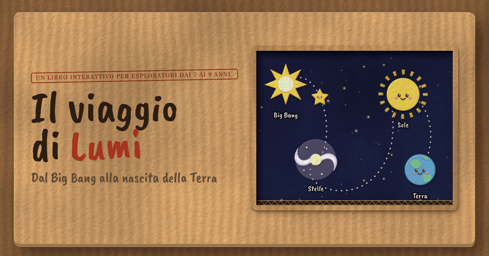

# Il viaggio di Lumi



An interactive picture book for children aged 7–9, in Italian: from the Big Bang
to the birth of the Earth. It has four lessons of about 30 minutes each, and
each lesson ends with a quiz and a medal. The book ends with a printable
diploma.

Built with [Bun](https://bun.sh) and [Astro](https://astro.build) as a fully static
site, with vanilla CSS. The games are vanilla JS web components and
[Alpine.js](https://alpinejs.dev) drives the app shell around them. The pages ship
no framework runtime beyond Alpine.

## Commands

```sh
bun install       # once, after cloning
bun run dev       # dev server with live reload on http://localhost:3000
bun run build     # static site in dist/
bun run preview   # serve dist/ locally
```

## Structure

```
astro.config.mjs           Astro config: YAML imports, writes sw.js after the build
AUTHORING.md               how to edit (and translate) the texts, for non-developers
src/
  content/it/              ALL the texts of the book, and nothing else (see AUTHORING.md)
    index.md               the book cover (home page)
    lezione-N/NN-name.md   one Markdown file per page, ordered by their number
    _data/lessons.yml      the 4 lessons (title, subtitle, date)
    _data/ui.yml           interface texts: menus, buttons, messages of the games
  content.config.ts        the Markdown pages as a content collection
  lib/book.ts              turns each content folder into a book (prev/next, index, TOC), matches pages with scenes
  lib/text.ts              md() · fill() · link() helpers for templates
  lib/sw-template.js       service worker template (offline cache + updates)
  pages/                   [...path].astro (every page of the book) · [...lang]/manifest.webmanifest.ts
  layouts/                 Base.astro (shell, top bar) · Slide.astro (book page, pager) · Home.astro (cover)
  scenes/                  the stage of each page (illustration + activity), code only:
                           lezione-N/NN-*.astro matches the page with the same lesson and number;
                           quiz.astro is shared by the four quizzes
  components/              Toc.astro · Sprite.astro (cut-out SVG symbols and the paper filters) · Medal.astro
                           Credits.astro (license footnote on cover + index)
  assets/css/              base.css (fonts, tokens, layout, page turn) · components.css · scenes.css · home.css
  assets/textures/         kraft, paper, black card, cut edge: tileable WebP baked by tools/textures/
  ../public/assets/         icons (icon.svg is the source of the PNGs) · social.png (README banner and og:image,
                           left out of the offline cache) · font licenses
  assets/fonts/            Caveat Brush, Patrick Hand, Stardos Stencil woff2 (OFL texts in public/assets/fonts/)
  assets/js/
    app.js                 navigation (arrows, keyboard, swipe, trackpad), offline, starts Alpine
    store.js               Alpine store for the app shell: stars, sound, read-aloud, index, progress marks
    core.js                texts (t()), saved progress (localStorage), paper confetti, paper sounds, "activity done" stars
    lamp.js                the desk lamp: pointer/tilt light and diorama parallax, lighter look on slow devices
    components.js          <scene-slider> <hold-button> <flip-card> <hot-spots> <sort-game>
                           <order-game> <tap-scene> <torch-reveal> <quiz-set> <nucleus-builder>
                           <fusion-game> <candy-jar> <anim-trigger> <name-cert>
    canvas.js              <space-canvas mode="bang|soup|static|gravity|supernova|accretion|earth">
```

## Offline and installable

The book is a PWA: it can be installed on a phone, tablet or computer, and it
works fully offline. After every production build, `astro.config.mjs` lists all the
files in `dist/` and writes `sw.js` from the `src/lib/sw-template.js` template, with a
version hash of the whole site. On the first visit the service worker stores
the whole book (about 1.5 MB).

When a new version is deployed, `sw.js` changes. The app checks for it when a
page loads, when the connection comes back and when the app returns to the
foreground (at most every 30 minutes). The new version downloads in the
background and shows up on the next page turn. The page on screen doesn't
reload.

`bun run dev` doesn't generate `sw.js`, and it removes any service worker
left over from a production build, so live reload keeps working.

## Texts and code are separate

Every text lives in `src/content/<lang>/`. Authors edit Markdown and YAML there without touching any code. See
[AUTHORING.md](AUTHORING.md). A page is a `.md` file. Its frontmatter holds the page details and the words of its
activity, and its body is Lumi's speech bubble:

```yaml
---
title: "Lo spazio si gonfia"
when: "Una frazione di secondo dopo il Big Bang"   # shown in the time badge
task: "What the child should do"                   # "Prova tu!" box
fact: "Fun fact"                                   # collapsible "Lo sapevi?" box
kind: cover | quiz | cert                          # optional
slider: { from: "🎈", to: "🎈🎈🎈", label: "..." }    # scene-specific texts, read by its scene
steps: ["...", "..."]
strings:                                           # texts the JS shows (see core.js t())
  boom: "..."
---
Lumi's speech bubble, in **Markdown**.
```

The stage (illustration + activity) is the scene with the same lesson and page number in
`src/scenes/lezione-N/NN-*.astro`. It gets the page data as props, so it writes `{slider.from}`,
`<Fragment set:html={md(spots[0].tip)} />` and so on. Scene-specific styles live next to the scene in a
`<style is:inline>@scope { … }</style>` block. Most scenes are SVG with a `viewBox="0 0 400 300"` inside a `.scene` (4:3).
`<scene-slider>` exposes `--t` (0→1) so a scene can morph purely in CSS. `<tap-scene>` and `<hold-button>` expose
`--p` in the same way.

The JS never contains text. `Base.astro` writes a JSON blob with `_data/ui.yml`'s `js:` texts plus the page's
`strings:`, and components read it with `t("key", { n })`. `{name}` placeholders work the same way in templates,
through the `fill()` helper.

**Languages.** `LANGS` in `src/lib/book.ts` lists the content folders. The first one is served at `/`, the others at
`/<lang>/`, each with its own page chain, TOC, manifest, read-aloud voice and date format (`ui.yml` → `app.locale`).
Content files can be renamed or translated freely, because scenes are matched by lesson and page number.

## Modern platform features used

Cross-document View Transitions (with forward/back types), `@scope`, CSS
nesting, `@layer`, `@property`, container queries, `:has()`, `@starting-style`
and `allow-discrete` transitions on `<dialog>`, `::details-content`, exclusive
`<details name>`, `linear()` easing, `oklch()`/`color-mix()`/relative colours,
`text-wrap: balance|pretty`, Service Worker + Web App Manifest (offline, installable), Web Animations, Web Audio (paper and board sounds synthesized from filtered noise), SVG filters
(`feTurbulence`, `feDisplacementMap`, `feSpecularLighting` for rough cuts, torn paper and relief), 3D page turns,
Device Orientation and Vibration, and the Speech Synthesis API (Italian read-aloud).

## How it was made

This project was generated by an AI assistant, [Claude](https://claude.ai) by
Anthropic. Claude wrote both the code and the content (lesson texts, quizzes
and illustrations). Two people reviewed the work.

## License

- **Code** (`astro.config.mjs`, `src/lib/`, `src/pages/`, `src/assets/js/`, `src/assets/css/`, `Base.astro`, `Slide.astro`,
  `Toc.astro`, `Medal.astro` and `Credits.astro`):
  [0BSD](LICENSE).
- **Content** (texts in `src/content/`, illustrations in `src/scenes/`,
  `src/layouts/Home.astro` and `src/components/Sprite.astro`):
  [CC0 1.0](LICENSE-CONTENT), public domain.
- **Fonts** (bundled in `src/assets/fonts/`, licenses in `public/assets/fonts/`): [Caveat Brush](public/assets/fonts/OFL-CaveatBrush.txt),
  [Patrick Hand](public/assets/fonts/OFL-PatrickHand.txt) and [Stardos Stencil](public/assets/fonts/OFL-StardosStencil.txt), under the SIL Open Font License 1.1.

You can use, copy, adapt and share the book, also in class or commercially,
without asking permission and without having to credit anyone. Only the fonts
keep their own license: if you redistribute them, include their `OFL-*.txt` files.
